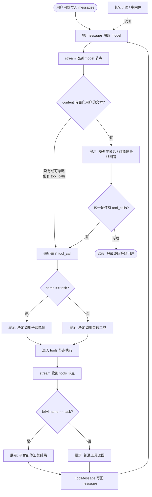

# 主层过程判断：逻辑梳理 + 面试要点

> 对应实践：`base/tavily_tools.py.py` 里对 `stream` / `astream_events` 的过程渲染。  
> 核心结论：**框架负责编排；业务负责把原始流翻译成可读过程。**

---

## 1. 一口复述（按理解串起来）

拿到一个 chunk，先看是图节点 **model**、**tools**，还是中间件之类。中间件不管；只处理 model 和 tools。

**如果是 model：**  
看有没有 `tool_calls`。

- **有**：遍历每一个；工具名是 `task` 就归成「要调子智能体」，别的就归成「要调对应工具」。有 content 的话整条 AIMessage 已经在上下文里，展示可选。框架接着去执行这些调用。
- **没有**：只剩最终 content → **结束循环**，把结果给用户。

**如果是 tools：**  
说明调用已经跑完了，看的是**返回**。工具名是 `task` → 子智能体返回结论；别的 → 对应工具的返回结果。

两边的结果都由框架写回 **Message（`state.messages`）**，再调 model。model 的新输出又变成新的 chunk，再走上面同一套判断。

所以多次循环的开关是：**模型还在不在下发 `tool_calls`**。  
判断时分清两层名字：图节点是 `model` / `tools`；工具名才是 `task` 或具体工具名（口语里的 `tool_name` 指后者，不要和节点名混用）。

分类逻辑负责**看懂过程**；**真正调工具、写回、再进 model** 是框架做的。

---

## 2. 这段逻辑是干嘛的？

| | 说明 |
|--|------|
| **不是** | 指挥 Agent「该不该调模型 / 该不该调工具」——那是框架已经跑完的 |
| **是** | 读 stream / events，认出「现在走到哪一步」，打成日志或推给前端 |

一句话：**框架做事，这段 if 做报幕式解说。**

企业里通常还会再包一层稳定的产品事件（如 `tool_call` / `subagent_start` / `assistant_delta`），前端只认事件协议，不认 `model` / `tools` 节点名。

---

## 3. 闭环流程图（编排环 + 展示分叉）

常见误区：把判断串成一条直线——

`先 model → 再 content → 再 tools → 再 task`

**实际是两层合在一起：**

- **外圈闭环（框架）**：`messages → model → tools → ToolMessage 写回 messages → 再 model`，直到没有 tool_calls。
- **菱形分叉（业务展示）**：每个 stream 节点上认出「在说话 / 调工具 / 调子智能体 / 谁回来了」。

「写回」= 追加进图状态的 `state.messages`，供下一轮 model 消费。

读图时抓住两层：

| 层 | 图上是什么 | 谁做的 |
|----|------------|--------|
| **闭环** | `Feed → model → tools → 写回 messages → 再 Feed` | 框架 |
| **展示** | 每个菱形 +「展示: …」方框 | 业务 Adapter |

### 分支对照表

| 分支 | 人话 | 典型展示 |
|------|------|----------|
| model + 有 content | 模型在说话 | 打字机 / 最终回答预览 |
| model + tool_calls + `task` | 决定派子智能体 | 类型 + description |
| model + tool_calls + 其它名 | 决定调普通工具 | 工具名 + 参数 |
| tools + name=`task` | 子智能体交差 | 汇总结果（常截断） |
| tools + 其它名 | 工具结果回来 | 返回预览（常截断） |

### 注意点

1. **model 与 tools 互斥**：同一次主图 chunk 不会既是 model 又是 tools。
2. **`task` 要判两次**：model 侧判「要去调谁」；tools 侧判「谁回来了」。
3. **content 与 tool_calls 可能同时有**：有的模型会边说话边调工具，产品上要定是否两边都展示。
4. **主层看不到子智能体内部多轮**：子图细节被包在一次 `task` 里；要细看用 `astream_events` 放开嵌套，或接 Trace。

---

## 4. 框架做 vs 自己做

| 事项 | 框架 | 业务 / 展示层 |
|------|:----:|:-------------:|
| 何时进 model / tools、何时调 task | ✅ | ❌ |
| 构造 AIMessage / ToolMessage | ✅ | ❌ |
| 认出并展示上面几类情况 | ❌ | ✅ |
| 过滤中间件 / 子图噪音 | ❌ | ✅（策略自定） |
| 截断、脱敏、SSE 字段 | ❌ | ✅ |
| 深层完整调用树 | 可接 LangSmith 等 | 一般不塞进主 UI |

`astream_events` 下过滤子图的常见信号：`metadata.langgraph_checkpoint_ns` 含 `|` → 视为嵌套，主层可 `continue`。

---

## 5. 面试会考吗？怎么考？

**会考**，尤其 Agent / LangGraph / 工具调用相关岗。  
很少让你默写 demo 里的 `if`，更常考**职责边界 + 循环机制 + 流式怎么给前端**。

### 考法 A：原理（高频）

> Agent 调用工具时，消息是怎么流转的？AIMessage 和 ToolMessage 分别是什么？

**答法要点：**

- 主循环大致是 `model ↔ tools`。
- 模型产出带 `tool_calls` 的 **AIMessage** → 进 tools。
- 工具执行完用 **ToolMessage** 写回 → 再进 model。
- 两类 Message 让下一轮模型分清「我说的」和「工具观察到的」。

### 考法 B：边界（易踩坑，答好加分）

> stream 里判断 model / tools / task，是框架帮你分好的，还是业务自己写的？

**答法要点：**

- **编排**（何时进节点、何时调 task）是框架做的。
- **展示分类**（认出并打印/推 SSE）是业务自己做的 Adapter。
- 一句话：**框架做事，业务解说；复杂功能挂在自己的事件协议上，不重写框架路由。**

### 考法 C：多 Agent（中频）

> 主 Agent 调子 Agent，外层 stream 能看到子 Agent 每一步吗？

**答法要点：**

- deepagents 一类实现里，委派常封装成特殊工具（如 `task`）。
- 主层通常只看到：开始调 `task` → 返回汇总 ToolMessage。
- 内部多轮是子图；主层默认滤掉，细节进 Trace 或单独放开嵌套事件。

### 考法 D：工程落地（偏资深 / 前端联调）

> 前端实时进度怎么做？会不会把 LangGraph 节点名直接暴露给前端？

**答法要点：**

- 不建议前端直接吃 `model`/`tools`。
- Adapter 映射成稳定事件：`assistant_delta` / `tool_call` / `subagent_start` / `tool_result` / `subagent_end` / `run_finished`。
- 用户侧浅层进度；运维侧完整 Trace。

### 考法 E：易错追问

> 为什么不能写成：先判断 model，再判断 content，再判断是不是 tools？

**答法要点：**

- model 与 tools 是**同一层上的互斥分叉**，不是先后关卡。
- content / tool_calls 只在 **model 分支内**；`name == task` 在 **model 决策侧和 tools 返回侧各判一次**。

---

## 6. 30 秒口述版（可背结构）

> Agent 的 model/tools 循环和 AIMessage/ToolMessage 是框架保证的。  
> 我这边用 stream 或 astream_events 做主层过程映射：先分模型侧还是工具侧；模型侧看 content 还是 tool_calls；tool_calls / 返回里再用名字区分普通工具和子智能体（如 task）。  
> 子 Agent 在主层当一次工具往返；深层细节走 Trace。  
> 产品上会落成自己的事件协议给前端，而不是把图节点名直接暴露出去。

---

## 7. 答错扣分 vs 答对加分

| 减分说法 | 加分说法 |
|----------|----------|
| 「这些判断都要自己写，框架不管」 | 「编排框架管；展示分类业务管」 |
| 「框架全自动，业务不用管 stream」 | 「要过程可视化就必须做 Adapter」 |
| 只背节点名、背 API | 能讲清 Message 协议 + 产品事件分层 |
| 「子 Agent 每一步主 stream 都能看到」 | 「主层通常只见 task 起止；深层另接观测」 |

---

## 8. 最小实现清单（复习用）

1. 过滤：非主图 / 无 messages / 中间件 → 忽略  
2. 分流：model vs tools  
3. 模型侧：有文本 → 输出；有 tool_calls → 分 task / 普通工具  
4. 工具侧：按 name 分 task 返回 / 普通工具返回  
5. （可选）结束判定、用量统计、错误事件、产品事件协议  

做到 1–4，主层过程可视化就完整。
